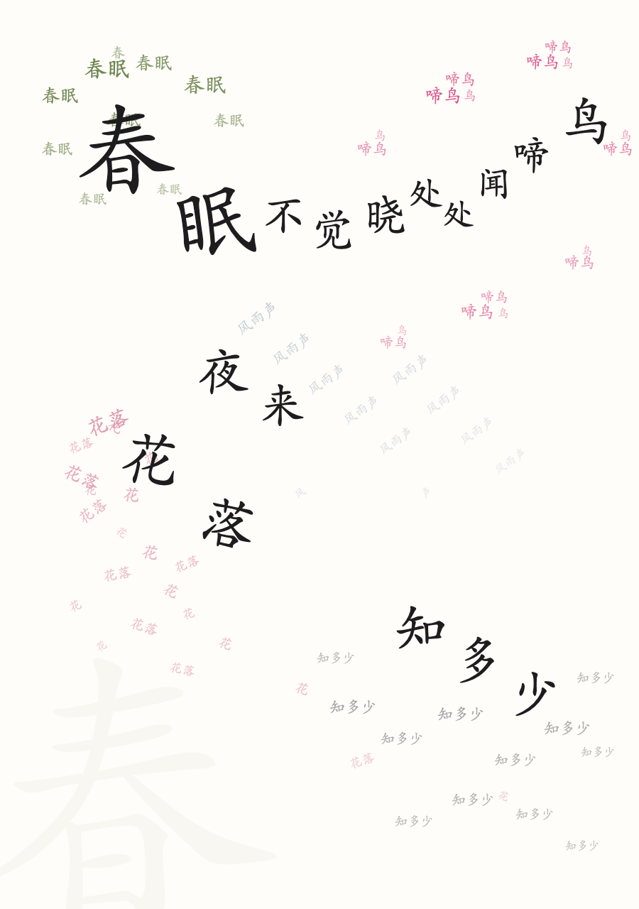
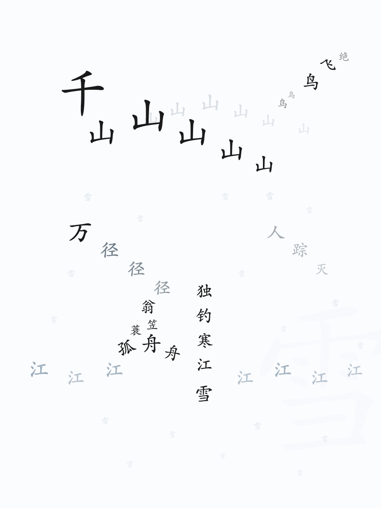
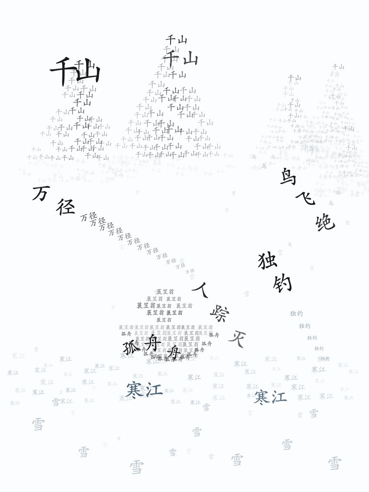
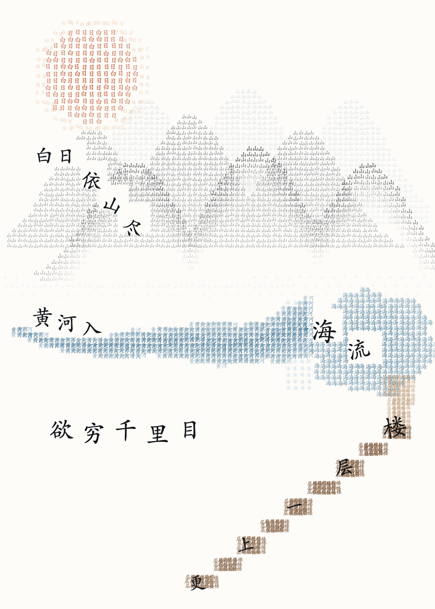

# 诗词文字画 · Poem Text Picture

把一首古诗排成一幅**只由诗中文字组成**的画：字的位置和走向就是画面本身——既能看出山水，也能顺着一条路径把整首诗一字不差读下来。



## 是什么

一个字都不许外来：图里所有的「山」「舟」「雪」都是诗里本来就有的字，重复使用只为堆出形与色。规则只有四条：

1. 字字出自原诗
2. 不看原诗能认出画面
3. 沿一条路径能一字不差读完
4. 每个意象由**指称它的字**构成；疑问、否定、比喻的字只占空白，不当实物

## 怎么做的（四步）

| 步骤 | 做什么 |
|---|---|
| 一 · 找事实 | 只写诗里真有的：物、方位、动作、方向、体积。不补任何诗外元素 |
| 二 · 定投影 | 关系换空间：垂下＝弧线降落＋逐字旋转；高远＝竖排或字号递减；风雨水＝斜线重复；聚散＝密度变化 |
| 三 · 设色设形 | 一色一义（≤5 色）；四级字号；六种造形手法；一条主轴；留白 ≥45% |
| 四 · 排出来 | 纯 `<text>` 的 SVG（不许 line/circle/path/image），再导 PNG 自检 |

完整提示词见 [`references/prompt-v2.md`](references/prompt-v2.md)，可直接复制给任意模型。

## 两种造形模式

| 模式 | 适合 | 做法 |
|---|---|---|
| **A 单字领袖** | 意象少、要清朗（静夜思、春晓） | 每个意象 1–2 个大字 + 回声小字 |
| **B 字群成体** | 对象有体积（山、船、楼、云、树、花林） | 几十上百个字按剪影堆满，**外缘即轮廓，密度即体积** |

同一首《江雪》的两种做法：

| 单字领袖 | 字群成体 |
|---|---|
|  |  |

### 高密度版：《登鹳雀楼》



太阳是三百个「日／白」排成的圆，山是三层「山」叠出的剪影（远淡近浓、山脚化雾），黄河是有宽度会弯的河道，「楼」沿九级台阶**一级一字**递升。做法见 [`references/advanced-render.md`](references/advanced-render.md)，生成器 [`examples/gen_dengguanquelou_dense.py`](examples/gen_dengguanquelou_dense.py)。

关键三条：**形状用几何包含不用概率撒点**、**填实率 ≈95%**、**主字挖空**（填字时跳过主字矩形，大字周围自然留白）。

「成体」的参数只有三行：

```python
t     = (y - peak) / (base - peak)      # 0 在峰顶，1 在山脚
halfw = width * t ** 1.25               # 峰顶窄、山脚宽
alpha = (0.97 - 0.55 * d) * (1 - 0.4 * t)   # 离轴越远越淡、越低越淡
```

山脚再用更小更淡的同字向外扩 3–5 圈做**雾化**——这是像国画而不像贴纸的关键。
完整生成器见 [`examples/gen_jiangxue_silhouette.py`](examples/gen_jiangxue_silhouette.py)（山形、船体、点径、水带四种函数，改参数即可复用）。

## 安装为 WorkBuddy Skill

```bash
git clone https://github.com/zhangswings/poem-text-picture.git ~/.workbuddy/skills/poem-text-picture
```

之后在 WorkBuddy 里说「把《枫桥夜泊》画成文字画」「用诗里的字排一幅山水」「诗词文字画」即可触发。

## 目录

```
SKILL.md                          # 技能入口：执行流程、自检清单、铁律
references/prompt-v2.md           # 提示词 v2.1（可复制使用）
references/visual-system.md       # 色卡、四级字号、六手法、成体参数表、SVG 片段
references/case-study.md          # 与优秀范例的差距分析
references/advanced-render.md    # 高密度渲染六条工程做法与四个坑
scripts/build.py                  # SVG＋推理文字 → 单文件教学页 HTML（可选导 PNG）
assets/template.html              # 教学页版式（Apple 风格，深浅色、打印友好）
examples/                         # 示例作品与生成器（含高密度版《登鹳雀楼》）
```

## 构建教学页

```bash
python scripts/build.py --config poems.json --out poem-art.html --png
```

`poems.json` 每首诗给：`no / name / author / text / svg / facts / proj / path / checks`
（字段含义见 `scripts/build.py` 头部注释）。

## 常见失败

| 症状 | 修法 |
|---|---|
| 字群堆成方块 | 用 `半宽 = 全宽 × t^1.25`，行内按离轴距离衰减透明度 |
| 山是灰带不是峰 | 检查 t 的方向：t=0 在峰顶，半宽必须为 0 |
| 像贴纸 | 山脚、船底、云边加 3–5 圈雾化小字 |
| 有画无诗 | 造形只许用体字和淡字，主体诗句必须连续可读 |
| 颜色脏 | 砍到 3 色＋墨；最好全图只染一个意象（《江雪》只有「寒江」是蓝的） |

## License

MIT
